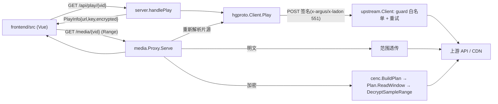

# Repository Guidelines

hgplayer 是红果短剧客户端的 Go / Wails v3 重构版：单二进制桌面应用，Go 后端在同一 origin 上提供 `/api/*` 与 `/media/*`，Vue 3 + TypeScript 前端经 `//go:embed all:frontend/dist` 嵌入并由 Wails `AssetServer` 承载。上游协议由 `internal/hgproto` 仿真，签名/密钥派生隔离在 `internal/sign`，媒体经 `internal/media` 代理并做 CENC 流式解密。设计背景见 `docs/重构方案.md`（P0–P6 里程碑，状态“待评审”）。

## Architecture & Data Flow

装配点全部在 `main.go`：`newApp` 构建 `apppath.Dirs → logx → device → sign.PlayerSigner → hgproto.Client → media.Proxy → server.Server`；`assetHandler` 把 `/api/`、`/media/` 路由到 `server.Server.Handler()`，其余交给静态壳页面，并在返回 `/`、`/index.html` 时下发 `player_session` Cookie。



关键分层（修改前先确认归属层）：

| 层 | 包 | 职责 / 关键符号 |
|---|---|---|
| 入口 | `main.go` | 对象图装配、`assetHandler`、`streamResolver`、`registerDevice` |
| HTTP | `internal/server` | 路由、中间件、JSON 编解码；`Handler()`、`chain()`、`SetSessionCookie` |
| 协议 | `internal/hgproto` | 目录/搜索/详情/取址/设备注册/排行榜；`Client.Play`、`RegisterDevice`、`BrowseList`、`Search`、`Series`、`RankPanel`、`Rank` |
| 签名 | `internal/sign` | Gorgon/Argus/Ladon/Medusa/Spade/TTEncrypt；`Argus551`、`Ladon551`、`PlayerSigner`、`SpadeKeyDeriver` |
| 媒体 | `internal/media` | Range 透传、窗口化解密、片源并发竞速、单飞刷新；`NewProxy`、`serveWindows` |
| 容器 | `internal/cenc` | ISO-BMFF 解析/改写、CENC-AES-CTR；`BuildPlan`、`Plan.ReadWindow`、`Decrypt` |
| 出网 | `internal/upstream` | 唯一 HTTP 出口：`guard.CheckURL` → 注入 Signer → `DoWithRetry` |
| 支撑 | `account` `archive` `cache` `device` `apppath` `guard` `logx` | 见 `Key Directories` |

播放链路要点：前端从不直连 CDN；`/api/play/{vid}` 只给地址与密钥，`<video src="/media/{vid}">` 触发代理重新解析、按窗口抓取上游字节、就地解密，再以 200/206 回写。

## Key Directories

| 路径 | 用途 |
|---|---|
| `internal/server/` | 路由 `server.go`、中间件 `middleware.go`、各 `handler_*.go` |
| `internal/hgproto/` | 协议客户端与解析；`testdata/` 为真实抓包样例 |
| `internal/sign/` | 逆向签名原语；**唯一允许存放协议加密实现的位置** |
| `internal/cenc/` | MP4 box / CENC；`cenctest/fixture.go` 生成合成加密样本（非测试文件） |
| `internal/media/` | 代理与窗口解密（`proxy.go`、`window.go`、`range.go`） |
| `internal/upstream/`, `guard/` | 出网客户端与域名白名单 |
| `internal/archive/` | `archive.json` + `.bak` 原子持久化（进度/收藏/搜索历史） |
| `frontend/src/` | `App.vue`（单页多视图）、`api/client.ts`（唯一 API 封装）、`contract.test.ts` |
| `build/` | Wails 平台 Taskfile、图标、NSIS/MSIX、Dockerfile |
| `docs/重构方案.md` | 目标、约束、验收指标 |

## Development Commands

前置：Go **1.26**、Node **22.x** + npm（`package-lock.json` 已提交）、`task`（go-task）、`wails3` CLI（库版本 `github.com/wailsapp/wails/v3 v3.0.0`）。

```bash
# 前端（每次改动 dist 相关逻辑前必跑）
cd frontend && npm ci && npm run build   # vue-tsc --noEmit && vite build
npm test                                  # vitest run

# Go（根包依赖 frontend/dist，务必先构建前端）
go build .
go vet . ./internal/...
go test ./...

# 应用
task dev          # wails3 dev，Vite 端口 9245（--strictPort）
task build        # 产物在 bin/，如 bin/hgplayer.exe
task run          # 平台原生运行
task package      # NSIS/MSIX/.app/.dmg/appimage/deb/rpm
task build:frontend   # common 任务，只构建前端
```

- `//go:embed all:frontend/dist` 使 `go build/vet/test`（根包）依赖已构建的前端；干净 clone 先 `npm ci && npm run build`。
- 直接 `go build .` 会在仓库根产生 `hgplayer.exe`；规范产物用 `go build -o bin/... .` 或 `task build`。
- `task build:server` / Docker server 模式目前**未实现**：没有任何 `//go:build server` 入口，`internal/server` 只暴露 `Handler()`，不监听端口。不要假设 `bin/hgplayer-server` 或 `Dockerfile.server` 可运行。
- `frontend/bindings/` 由 `wails3 generate bindings` 生成且被 gitignore；`frontend/src` 未引用它（依赖的 `@wailsio/runtime` 未安装），视为死代码。

## Code Conventions & Common Patterns

**语言与注释**：包级 `// Package x ...` 与全部注释、用户可见错误文案均为中文，解释“为什么”（身份/安全/性能约束），不是复述代码。导出标识符配中文文档注释。

**HTTP 处理**

- Go 1.22 `http.ServeMux` 方法前缀路由，集中在 `server.Handler()`；路径参数用 `r.PathValue("id")`，query 默认值用 `atoiDefault(q.Get("page"), 1)`。
- Handler 签名固定 `func (s *Server) handleX(w http.ResponseWriter, r *http.Request)`；薄 handler：解析入参 → 调包 → `writeJSON`。
- 响应一律 `writeJSON(w, status, v)`（`application/json; charset=utf-8` + `Cache-Control: no-store`），无通用成功包裹；稀疏响应用 `map[string]any{"success": true}`，复杂响应用具名未导出 struct（`versionResponse`、`progressRequest`）。
- JSON tag 一律 `snake_case`，可选项 `omitempty`；`archive.Progress` 与 handler 内部镜像结构（`handler_account.go` 的 `archiveProgress`/`archiveFavorite`）需同步修改。
- 错误体为 `{"code"?: string, "error": string}`，`error` 是面向用户的中文。状态映射：`hgproto.IsInputError(err)` → 400，其余上游错误 → 502，`Proto == nil` → 503；媒体错误 `ENC_REQUIRED`(501)/`MEDIA_PROXY_FAILED`(502)，已开始写响应后必须返回 `ErrResponseStarted` 而不是改状态码。
- 中间件链 `errorWrap(sessionGuard(logAccess(next)))`：panic → 500；`/api/*` 需 `player_session` Cookie（`/media/*` 有意不校验）；日志只记 method + path（不记 query，避免凭证落盘）。

**分层与依赖**

- 新增上游域名必须同时更新 `hgproto.AllowedDomains`（`internal/hgproto/hgproto.go`）；媒体侧还有独立的 `allowedMediaHosts`（`internal/media/proxy.go`）。所有出网走 `upstream.Client`，不要直接 `http.Get`。
- 协议加密只写进 `internal/sign`：底层小写辅助函数留在 `bits.go`/`hex.go`，导出包装集中在 `metadata.go`/`playback551.go`/`spade.go`/`ttencrypt.go`。
- 错误处理：需要保留因果链时 `fmt.Errorf("...：%w", err)`；哨兵错误用包级 `var ErrX`；输入错误用 typed `inputError`，不要靠字符串匹配。现有代码部分位置用 `%v`，改动时就近修成 `%w`，不整包重写。
- 并发：状态用 `sync.Mutex`/`RWMutex`；媒体用单飞（`refreshOnce`、window in-flight）而不是全局锁；`context` 从 `r.Context()` 贯穿到底，超时由 `upstream` 客户端统一设置，handler 不额外加 deadline。
- 顺序即语义：签名输入依赖 query/body 的**字节级顺序**。`encodeOrderedQuery`/`playbackDeviceOrdered` 的顺序不可重排；map body 依赖 Go 对 key 排序（有意为之）；注册 header 顺序由 `bootstrapHeaderOrder` 固定。签名后不得重新编码。

**不可破坏的协议不变量**

- 播放（`/novel/player/video_model/v1/`）只用真实 551 信封 `x-argus`/`x-ladon`，**禁止**加 `x-medusa` 或 4 字节 stub；目录/搜索/详情保持 stub + `x-medusa`。混用会得到 200 + 空 body。
- branch 值：播放 `1`，元数据/搜索 `0`；`x-khronos` 必须等于签名用 `ts`；`_rticket` 以固定毫秒基准递增直到 branch 命中。
- 空 200 表示上游拒绝（设备节流），只有 `Play` 会消耗设备重试；`upstream` 重试策略不覆盖 5xx（5xx 作为正常响应返回）。
- 设备注册档案必须与播放档案一致；`SetDevice` 必须重建两个 upstream channel（`device_id`/`iid` 已烘进 `upstream.Options`），持久化字段不要用默认档案覆盖。
- 身份变化（登录/登出/设备重置）必须 `cache.Invalidate()`。
- 榜单：`cell/change` 的分类选择器用 `tab_type=26` 拉取，列表首页 `2`、续页 `1`；游标是前端原样回传的不透明 JSON（`offset/session/filter`），不要拆开或改写，`filter_ids` 依赖其中的已出现 ID 去重。

**CENC / 媒体不变量**

- `plain = upstream + Shift`；`Plan.ReadWindow` 要求取回长度恰为 `uEnd-uStart`；`BuildPlan` 会改写 moov/stco，必须 clone head。
- 容器改写需删除 `senc/saio/saiz/sgpd/sbgp`、去掉 `sinf`、经 `frma`（或 avcC/hvcC）还原 `encv/enca`、更新 `stsd` 计数与大小、重定位 `stco/co64`；漏一步即不可播放。
- 限制：不支持 `moof` 分片、`senc` 子样本、`saio/saiz`；IV 恰 8 字节；样本数 ≤ 100000；box 嵌套 ≤ 32。Range 只支持单段。
- 备用片源是**并发竞速**（`getUpstreamAny`），关闭响应体必须取消落败分支；缓存键 = URL 尾段 + content key（`mediaFingerprint`）。

**前端**

- 只发同源相对路径 `/api/...`、`/media/...`，`credentials: 'same-origin'`；无 Vite proxy、无 base URL。`contract.test.ts` 锁死了这条约定。
- API 类型在后端 struct 与 `frontend/src/api/client.ts` 之间**手工镜像**（未生成）；改 Go 响应结构必须同步改 TS interface 与 `App.vue` 消费处。
- 视图切换靠 `App.vue` 内 `view` ref（`catalog|search|series|player|history|favorites`），无 vue-router；`<video>` 直接取 `/media/${encodeURIComponent(vid)}` 以保留 Range 语义。

## Important Files

| 文件 | 作用 |
|---|---|
| `main.go` | 入口、对象图、`assetHandler`、`streamResolver`、`registerDevice`、`version` 变量 |
| `internal/server/server.go` | 唯一路由表 + `Config`/`Server` 定义 |
| `internal/server/middleware.go` | 会话 Cookie、panic 包装、访问日志 |
| `internal/server/handler_media.go` | 错误码到媒体响应的映射 |
| `internal/hgproto/play.go` | 取址主路径：签名 query/header、`parseEntryPlayInfo`、密钥派生、URL 校验 |
| `internal/hgproto/register.go` | `tt-data` 注册信封、固化 header 顺序 |
| `internal/hgproto/client.go` | `Client`、设备切换、`doJSONRaw`、空 200 处理 |
| `internal/hgproto/rank.go` | 排行榜：`cell/change` 参数、分类选择器解析、`{offset,session,filter}` 游标 |
| `internal/server/handler_rank.go` | `/api/rank/panel`、`/api/rank` 参数校验与响应 |
| `internal/sign/playback551.go` | 551 代 Argus/Ladon 实现 |
| `internal/sign/medusa.go` | `x-medusa` 与 AES 变体 |
| `internal/media/proxy.go` / `window.go` | 代理主流程、解密计划缓存、窗口抓取/解密/回写 |
| `internal/cenc/plan.go` / `decrypt.go` | 平面↔上游映射、样本解密与容器改写 |
| `frontend/src/api/client.ts` / `App.vue` | 前端契约与全部 UI 逻辑 |
| `Taskfile.yml`, `build/Taskfile.yml` | 构建/打包/绑定生成的真实命令 |
| `.github/workflows/ci.yml` | 唯一的 CI 契约 |

## Runtime/Tooling Preferences

- **Go 1.26**，Windows 构建 `CGO_ENABLED=0`（这也是测试不用 `-race` 的原因）；依赖仅 Wails v3 + `golang.org/x/text`，新增依赖需谨慎。
- 包管理器固定 **npm**（`PACKAGE_MANAGER` 默认值，`package-lock.json` 入库）；Node 22，Vite 7，Vue 3.5，TypeScript strict + `noEmit`（类型检查由 `npm run build` 把关）。
- 无 golangci-lint / staticcheck / gofmt 检查步骤；格式遵循 `gofmt` 默认。
- Vite dev 端口：`build/config.yml` 与 `task dev` 用 9245（`--strictPort`）；`vite.config.ts` 内的 5173 已过期。
- `version` 仍是硬编码 `var version = "0.1.0"`，Taskfile 未传 `-ldflags -X`；不要声称版本由构建注入。
- 平台打包依赖：Windows NSIS/MSIX 工具、macOS `codesign`/`lipo`（部署目标 12.0）、Linux gcc/clang（否则走 `wails-cross` Docker 镜像）、`garble v0.16.0` 仅用于 `OBFUSCATED=true`。

## Testing & QA

- Go：`go test ./...`。12 个包有测试、约 150+ 顶层 `Test*`，无根包测试；按包内（同 package）编写以访问未导出字段，不要改成 `_test` 外部包。
- 全部测试离线：HTTP 交互用 `httptest.Server`；守卫通过 `hgproto.WithGuard(nil)`、`proxy.allowHost`、可注入 `p.decrypt` 打开；端点用 `Client` 的 override 字段改写。
- 风格：表驱动 `cases := []struct{...}` + `t.Run`；辅助函数 `newX(t, ...)`、`xFixture`、fake 接口（`recordingSigner`、`rangeUpstream`、`flakyResolver`）；所有接收 `*testing.T` 的辅助函数首行 `t.Helper()`；断言用 `t.Fatalf`/`t.Errorf` + 中文消息，**不引入 testify**。
- 样本：`internal/sign/testdata/medusa_vector.json`（由 `medusa_ref.js` 生成，后者是文档不可直接运行）、`internal/hgproto/testdata/{series_page.html,website_search.json}` 为真实抓包；`internal/cenc/cenctest.Build` 生成合成加密 MP4。Spade 向量在 `sign/spade_test.go` 与 `hgproto/play_test.go` 重复，需**两处同改**。
- 黄金向量是字节级契约：改签名算法必须同步更新向量与溯源注释。真实抓包测试（96 集、10 张卡片）是解析回归的第一道防线。
- 前端：仅 `frontend/src/contract.test.ts`（vitest，无 config、无 setup、显式 import）。jsdom 与 `@vue/test-utils` 已装但未使用；没有组件测试。
- CI：`windows-latest` + `macos-latest`（无 Ubuntu），顺序为 `npm ci → npm run build → npm test → go build . → go vet . ./internal/... → go test ./...`；失败不短路。无覆盖率阈值、无 `-cover`、无 `-race`。
- 时序敏感测试（cache 10/20ms、upstream 50ms、media 300ms 竞速）不要收紧超时。
- 手工验证：`task dev` 打开窗口，走 目录 → 详情 → 播放；加密片源验证拖动进度条（Range + 窗口解密）。媒体样本放 `media/*.mp4`（已 gitignore）。