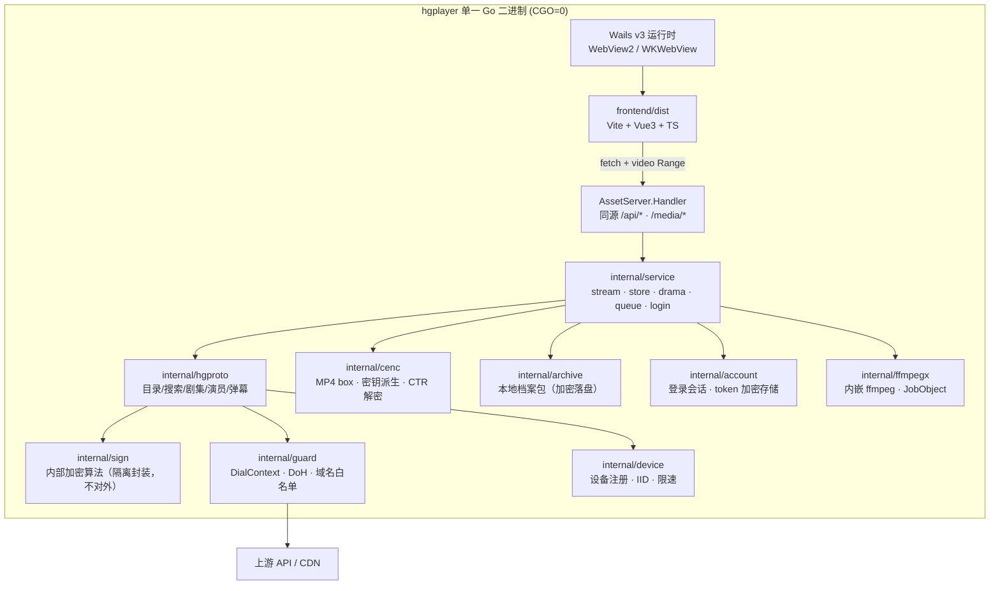

# 红果短剧客户端性能优化与技术栈升级方案

| 项 | 内容 |
|---|---|
| 提案名称 | 红果短剧客户端性能优化与技术栈升级 |
| 提案类型 | 技术升级 / 架构重构 |
| 交付物 | `C:\github\hgplayer` 下的全新 Go / Wails 客户端 |
| 日期 | 2026-11-13 |
| 状态 | 待评审 |

---

## 目录

1. [背景与问题](#1-背景与问题)
2. [目标与非目标](#2-目标与非目标)
3. [技术选型理由](#3-技术选型理由)
4. [目标架构](#4-目标架构)
5. [重构方案分层](#5-重构方案分层)
6. [测试与质量保障](#6-测试与质量保障)
7. [分阶段计划](#7-分阶段计划)
8. [验收指标](#8-验收指标)
9. [风险与对策](#9-风险与对策)
10. [决策请求](#10-决策请求)

---

## 1. 背景与问题

当前红果短剧客户端基于 **Electron + Node/Express + 无构建 Vue3**。它已承载流媒体解密代理、签名协议仿真、离线转码等核心能力，但架构层面的冗余与性能瓶颈已明显拖累交付效率与运行时体验。

现状量化（以同栈开源参照项目 `hongguo-open-player` 的代码结构为同构样本，红果客户端规模量级相当）：

| 维度 | 现状 | 影响 |
|---|---|---|
| 代码规模 | 约 16,000 行，其中后端 6,808 行、Electron 壳 338 行、前端 2,870 行 | 模块边界模糊，改动牵一发动全身 |
| 运行时外壳 | Electron，内嵌完整 Chromium | 包体数百 MB 级，内存常驻重 |
| 后端线程模型 | Node 单线程事件循环 | 解密/转码等 CPU 密集任务挤占 I/O，成为性能天花板 |
| 媒体处理 | 解密走整文件缓冲，转码每次 fork ffmpeg | 内存峰值高、冷启动转码有明显延迟 |
| 前端形态 | 无构建、单文件巨型组件、in-DOM 模板、`unsafe-eval` CSP | 编译期无法优化，运行时模板编译耗 CPU |
| 启动链路 | Electron 冷启动 + 本地 Express 服务拉起 | 首屏到可播时间长 |

**核心矛盾**：现有栈的冗余，本质是"用浏览器内核（Chromium）承载一个本地流媒体解密/转码后端"的错配——内核的体积、内存、线程模型都与该后端的核心诉求（CPU 密集、低延迟、单文件分发）不符。

---

## 2. 目标与非目标

### 2.1 目标

1. 迁移到 **Go / Wails** 技术栈，去除 Electron 与 Node 运行时；
2. 消除运行时冗余，达成明确的性能与体积指标（见 [§8 验收指标](#8-验收指标)）；
3. **新增登录功能**，并**保留本地档案包功能**（收藏/进度/历史的本地持久化不丢失，与账号并行）；
4. 提升可维护性：模块解耦、类型化、可测试、可独立替换。

### 2.2 非目标

- 不改变现有业务功能与上游协议契约（行为必须一致）；
- 不改变 UI 设计语言与交互；
- **不向外部 AI 编程工具暴露内部加密算法源码**。

---

## 3. 技术选型理由

| 对比项 | 现状（Electron） | 目标（Go / Wails） | 收益 |
|---|---|---|---|
| 外壳 | 内嵌 Chromium（数百 MB） | 系统 WebView（WebView2 / WKWebView） | 包体大幅下降、内存下降 |
| 后端语言 | Node（单线程、JIT、大缓冲） | Go（原生线程、低 GC 开销、静态二进制） | CPU 密集任务不再阻塞 I/O |
| 分发形态 | 多文件 Electron 包 | **CGO=0 单一二进制** | 安装/分发/更新成本下降 |
| 前端 | 无构建全局脚本 | **Vite + Vue3 + TS** | 编译期优化、类型安全、去掉 `unsafe-eval` |
| 生态契合 | 用 JS 重造一切 | Go 标准库 `net/http`、`crypto` 直给 | 依赖少、可维护性高 |

### 3.1 内部加密算法的合规边界

需要在评审中明确并达成共识：

- **内部加密算法源码仅限内部环境可见**，不进入任何外部 AI 编程工具的工作上下文，也不进入外部仓库；
- 方案中，该部分被隔离为**独立的、边界清晰的内部包**（`internal/sign`），以接口暴露、内部实现封装，既便于审计与替换，也确保敏感代码不扩散；
- **逆向分析、开源社区公开可得的实现允许**作为算法行为的参照与移植来源，不涉及内部源码泄露。

> 该隔离设计本身即是可维护性收益：敏感算法从业务代码中剥离，业务层只依赖接口，后续算法升级或替换不影响其余模块。

---

## 4. 目标架构



**设计要点**：前端与 `/api`、`/media` **同源**（挂载到 Wails 的 `http.Handler`），复用现有"相对路径 + 同源"契约，前端 24 处 API 调用与 `<video>` 流无需改动语义。

### 4.1 目标仓库结构

```
hgplayer/
├── main.go                     # wails.Run + options
├── go.mod                      # go 1.25+，CGO_ENABLED=0
├── wails.json
├── frontend/                   # 前端（Vite + Vue3 + TS）
│   ├── index.html
│   ├── vite.config.ts
│   ├── src/{App.vue,views/,components/,composables/,lib/,api/,types/}
│   └── src/assets/app.css
├── internal/
│   ├── app/         bindings.go window.go menu.go tray.go datadir.go
│   ├── server/      router.go middleware.go static.go
│   ├── service/     stream.go store.go drama.go queue.go logx.go
│   ├── hgproto/     playurl.go catalog.go search.go appsearch.go
│   │                appcatalog.go actor.go danmaku.go sharelink.go
│   ├── sign/        gorgon.go medusa.go helios.go argus.go
│   │                simon.go ladon.go khronos.go ssstub.go ttencrypt.go
│   ├── cenc/        box.go moov.go spade.go ctr.go rangeplan.go
│   ├── guard/       guard.go doh.go blocklist.go
│   ├── device/      device.go register.go iidpool.go ratelimit.go
│   ├── media/       transcode.go mse.go blobcache.go
│   ├── ffmpegx/     embed_arm64.go embed_amd64.go extract.go
│   │                jobobject_windows.go jobobject_other.go
│   ├── archive/     archive.go  （本地档案包：收藏/进度/历史）
│   └── account/     account.go  （登录会话：加密存储、凭证注入）
└── .github/workflows/{ci.yml,live-verification.yml,build-release.yml}
```

> `internal/` 在 Go 中即为**模块内部包**，外部导入被语言层面禁止。这是内部加密算法隔离的天然技术保障。

---

## 5. 重构方案分层

### 5.1 后端（Node → Go）

| 现有模块 | 行数（同构参照） | 目标包 | 说明 |
|---|---|---|---|
| `server/index.js` 路由 | 494 | `internal/server` | 改用 Go 1.22 `ServeMux` 模式路由，Express 中间件 → `http.Handler` 链 |
| `services/streamService.js` | 684 | `internal/service` | 流式管线改为 Go `io.Reader/Writer`，消除整文件缓冲 |
| `services/storeService.js` | 250 | `internal/archive` + `internal/account` | **拆成两条**：本地档案包（JSON 原子写）与账号会话（加密存储） |
| `services/dramaService.js` | 190 | `internal/service` | 协议编排 |
| `native/*.js` 协议层 | ~3000 | `internal/hgproto` + `internal/sign` | `axios` → `net/http`；签名层封装进隔离的 `internal/sign` |
| `native/bytevc2-transcode.js` | 117 | `internal/ffmpegx` | `os/exec` + 内嵌 ffmpeg，Windows 用 JobObject 防孤儿进程 |
| `native/web-media-guard.js` | 204 | `internal/guard` | 自定义 `Transport{DialContext}` 等价复刻 SSRF 防护 |

#### 性能专项

- **媒体解密去整文件缓冲**：现有实现整文件读入 + `concat` 输出，内存峰值高。Go 侧改用**流式分块解密**（`io.Reader` 逐块 + AES-CTR），峰值内存从"文件级"降到"窗口级"（512 KiB 量级）。
- **转码常驻化**：评估 ffmpeg 改为常驻子进程 + 管道复用，避免每次请求 fork 的冷启动开销。
- **goroutine 并发模型**：解码、转码、下载天然适配 goroutine，CPU 密集任务与 I/O 并行，消除单线程阻塞。

### 5.2 前端（无构建 JS → Vite + Vue3 + TS）

| 现状 | 目标 |
|---|---|
| 2,177 行单文件组件 | 按视图拆 SFC（header / 目录 / 榜单 / 影院 / 侧栏 / 弹窗） |
| 979 行 in-DOM 模板 | 组件模板 + 编译期优化 |
| 全局脚本、隐式全局（`Vue`/`Danmaku`/`Bytevc2Stream`） | ESM import，类型化 |
| `unsafe-eval` CSP（运行时模板编译） | **编译期编译，彻底消除 `unsafe-eval`**（安全 + 性能双重收益） |
| 弹幕库 DOM 直操 | 保留命令式引擎，改 import |

### 5.3 登录功能（新增）

| 关注点 | 方案 |
|---|---|
| 会话模型 | `Device + Account`：保留匿名设备身份，叠加可选账号身份 |
| 凭证注入 | 统一在上游请求出口注入账号凭证；登录标志由硬编码改为动态 |
| 存储 | 账号 token 走 **OS 密钥链**（Windows DPAPI / macOS Keychain）加密落盘，**不裸写文件** |
| 缓存失效 | **登录/登出必须整体清空**进程内缓存（目录游标、片源地址），防止跨身份复用——正确性关键点 |
| 401 语义 | 区分"本地会话未建立"与"上游账号 token 过期"，前端分别处理 |
| 日志脱敏 | 凭证不进 query、不进日志；上游响应头携带会话时确认不被序列化 |

### 5.4 本地档案包（保留）

**定位不变**：收藏、进度、观看历史、搜索历史的**本地持久化**，不依赖账号，登录与否都可用。

- 存储：JSON + `os.CreateTemp` + `os.Rename` 原子写，保留 Windows 文件锁重试与 `.bak` 回退（对齐现有崩溃一致性断言）；
- **与登录并行**：登录后提供"账号同步"作为可选增强，**默认仍以本地档案包为准**，避免未登录用户数据丢失；
- 加密落盘：档案包可加本地口令加密（区别于账号 token 的密钥链托管）。

---

## 6. 测试与质量保障

| 策略 | 说明 |
|---|---|
| **黄金向量表驱动** | 签名/加密算法的既有标准向量直接移植为 Go table test，逐位比对，零设计成本 |
| **契约测试** | `/api/*` 的状态码与语义（401/202/206/`content-range`/`ftyp`）用 `httptest` 重写，对齐现有 e2e 断言 |
| **对拍测试** | 保留旧实现作为 oracle，对同一批样本比对输出，**唯一能保证"逐位一致"的手段** |
| **登录 / 档案包回归** | 登录、登出、缓存失效、本地档案包读写的回归用例 |
| **敏感代码隔离** | 内部加密算法封装为独立包，测试在内部进行，不进入外部协作上下文 |

---

## 7. 分阶段计划

| 阶段 | 内容 | 交付 | 门禁 |
|---|---|---|---|
| **P0 Spike** | Wails 骨架 + 同源 `/api` + 媒体 Range 实测 + WebView 播放验证 | 可行性结论 | 能用 `<video>` 拖拽播放本地加密 MP4 |
| **P1 基础设施** | `logx` / 本地档案包 / 设备 / 域名防护 / **隔离的加密算法包** | 后端基础层 | 算法黄金向量全绿 + 对拍一致 |
| **P2 协议层** | `hgproto` + `server` 路由 | Go 后端 | 行为契约 e2e 全通 |
| **P3 媒体** | CENC 流式解密 + ffmpeg 转码 | 媒体管线 | 解密产物与旧实现一致 |
| **P4 登录** | `internal/account` + 凭证注入 + 缓存失效 | 登录功能 | 登录/登出/会话过期用例 |
| **P5 前端** | Vite + Vue3 + TS，拆 SFC | 前端 | 前端契约测试 + 目视一致 |
| **P6 打包/CI** | 三平台打包 + CI + 发布 | 产物 | 6 个 artifact 可安装可播 |

**关键控制点**：P2 结束后，让 Go 后端先作为旧后端的 **drop-in 替换**跑通（同端口、同路由），把"后端重写"与"换壳"风险彻底解耦，任何一边出问题都能单独回滚。

**估算**（单人全职）：约 9–14 人周。

---

## 8. 验收指标

| 指标 | 现状基线 | 目标 |
|---|---|---|
| 安装包体积 | 数百 MB 级 | **下降 ≥ 60%** |
| 常驻内存 | Electron 基线（数百 MB） | **下降 ≥ 50%** |
| 冷启动到可播 | Electron 冷启动链路 | **下降 ≥ 40%** |
| 媒体解密内存峰值 | 文件级缓冲 | 降至窗口级（≤ 1 MiB 量级/请求） |
| 代码模块化 | 单文件巨型组件 + 全局脚本 | SFC + ESM + TS，类型安全 |
| 安全基线 | 依赖 `unsafe-eval` | **消除 `unsafe-eval`** |
| 功能完整度 | 无登录 | 登录可用 + 本地档案包保留 |

---

## 9. 风险与对策

| 风险 | 概率 | 对策 |
|---|---|---|
| 内部加密算法复刻出现逐位偏差 | 高 | 黄金向量 + 对拍测试；敏感代码隔离、内部验收 |
| WebView 媒体 Range / MSE 能力不足 | 中 | P0 Spike 先行实测，失败则回退 loopback TCP 服务 |
| macOS WKWebView 的自定义协议下播放/全屏劣化 | 中 | P0 实测；保留 `<video>` 主路径，MSE 仅作增强 |
| HEVC 在 WebView2 需扩展 | 中 | 沿用"选流优先 H.264 + bytevc2 转 H.264"策略 |
| 登录引入账号封禁风险 | 中 | 凭证加密托管；提供"仅本地档案包"的免登录模式作为兜底 |
| Wails v3 为新发布版本 | 中 | 锁定 minor 版本，不追 nightly |

---

## 10. 决策请求

请评审并批准：

1. **批准** Go / Wails 技术栈升级方向；
2. **批准**在 `C:\github\hgplayer` 建立新项目，按 P0→P6 分期交付；
3. **确认**内部加密算法的隔离与合规边界（仅内部可见、不进入外部工具上下文、允许使用逆向/开源公开实现作为参照）；
4. **批准**登录与本地档案包并行的方案设计。
